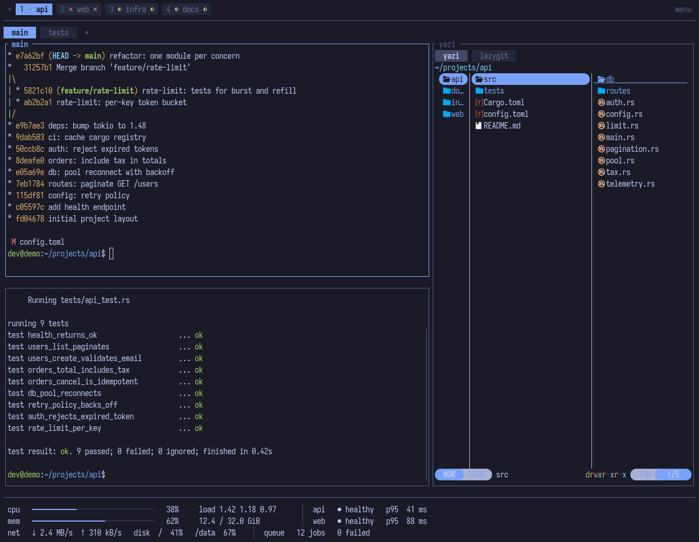

# ushineko/herdr

A personal fork of [herdr](https://github.com/herdrdev/herdr), the terminal
workspace manager for AI coding agents, carrying a few features on top of herdr
releases. **Not affiliated with the herdr project**: please do not report these
patches upstream.

| Feature | What it does |
| --- | --- |
| **Horizontal spaces bar** | Spaces in a bar across the top instead of the left rail, each with its agents' status folded in (`×` blocked, `◐` working, `✓` done). |
| **Dock** | A pane area along the bottom that belongs to no workspace: a monitor or log tail runs once and shows in every workspace and tab. |
| **Nested tabs** | Several panes in one layout slot behind a one-row strip, such as yazi and lazygit sharing one column. Scriptable with `herdr pane stack`. |

Builds stay compatible with stock herdr clients, servers and saved sessions.

- What each feature does, why, and how it was tested: [`ushineko/README.md`](../ushineko/README.md) and the specs: [000 spaces bar](https://github.com/ushineko/herdr/blob/ushineko/spaces-bar/ushineko/specs/000-spaces-bar.md), [001 dock](https://github.com/ushineko/herdr/blob/ushineko/dock/ushineko/specs/001-dock.md), [002 nested tabs](https://github.com/ushineko/herdr/blob/ushineko/pane-stacks/ushineko/specs/002-nested-tabs.md).
- Branches, building and moving to new herdr releases: [`ushineko/MAINTAINING.md`](../ushineko/MAINTAINING.md).
- herdr itself (installation, configuration, everything else): the upstream [README](../README.md) and [herdr.dev](https://herdr.dev).
