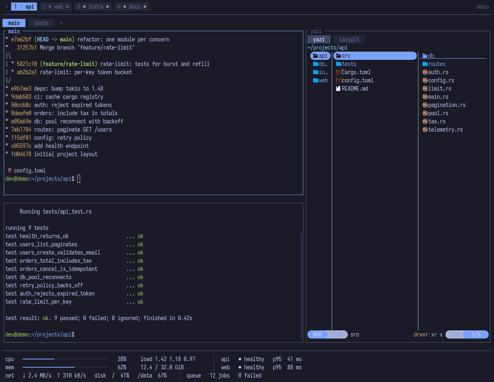

# ushineko/herdr — a personal herdr fork

This is a personal fork of [herdr](https://github.com/herdrdev/herdr) that
carries a few local features on top of herdr releases.

**It is not affiliated with the herdr project.** Do not report problems with
these patches upstream, and do not open issues or pull requests against
herdrdev/herdr on their behalf: herdr does not accept unsolicited pull requests
(see its `CONTRIBUTING.md`). Everything here is published in case it is useful
to someone, with no support promise.

*The spaces bar across the top (a blocked agent in `web`, working ones in
`infra` and `docs`), yazi and lazygit as nested tabs in the right-hand slot,
and the dock along the bottom, which shows the same programs in every
workspace. Demo content.*

## Features

| Feature | Branch | Spec | Status |
| --- | --- | --- | --- |
| Horizontal spaces bar: spaces in a two-row bar across the top instead of the left rail, with folded agent status per space | [`ushineko/spaces-bar`](https://github.com/ushineko/herdr/pull/1) | [000](https://github.com/ushineko/herdr/blob/ushineko/spaces-bar/ushineko/specs/000-spaces-bar.md) | Complete |
| Dock: a pane area along the bottom that belongs to no workspace and shows in every one | [`ushineko/dock`](https://github.com/ushineko/herdr/pull/2) | [001](https://github.com/ushineko/herdr/blob/ushineko/dock/ushineko/specs/001-dock.md) | Complete |
| Nested tabs: several panes in one layout slot behind a tab strip | [`ushineko/pane-stacks`](https://github.com/ushineko/herdr/pull/3) | [002](https://github.com/ushineko/herdr/blob/ushineko/pane-stacks/ushineko/specs/002-nested-tabs.md) | Complete |

Each feature is a branch stacked on the one before it and reviewed as a pull
request inside this fork (the branch links open the PRs), then merged into
`ushineko/features`. `ushineko/features` is the integration branch that
builds are made from.

## Base

herdr **v0.9.5**. Build tags are `ushineko-v<herdr version>.<n>`, for example
`ushineko-v0.9.5.1`.

## Compatibility

All patches keep herdr's stable endpoint contract (generation 1). New
behaviour is negotiated through endpoint capabilities and named controls, the
saved-session version is unchanged, and frozen wire messages are not touched.
A build from this fork interoperates with stock herdr clients and servers, and
rolling back to stock herdr keeps your sessions.

See [MAINTAINING.md](MAINTAINING.md) for the branch model, how the patches
are carried across herdr releases, and how to build and validate.
